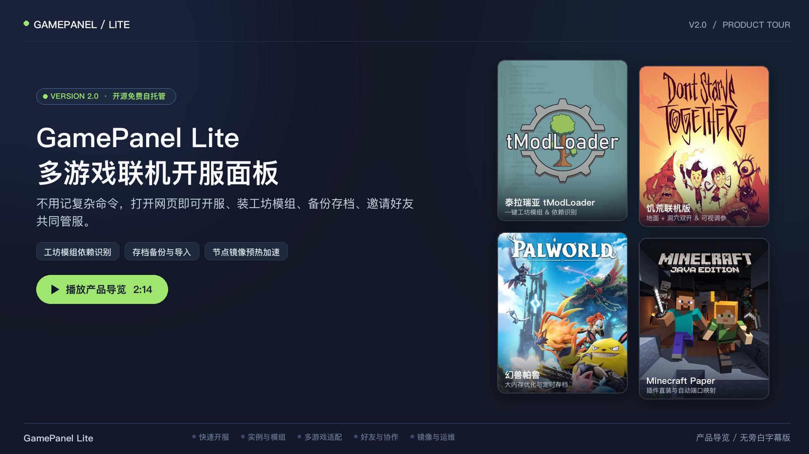

# GamePanel Lite

<p align="center">
  <strong>现代化、声明式、开箱即用的自托管多人联机游戏服务器管理面板</strong>
</p>

<p align="center">
  <a href="https://dev.gamepanel.site">在线体验 Demo</a> · <a href="./README_EN.md">English</a> · <a href="#快速开始">快速开始</a> · <a href="#支持的游戏">支持的游戏</a> · <a href="./docs/deployment-and-https.md">HTTPS 与运维</a> · <a href="./docs/game-guides.md">游戏开服指南</a> · <a href="./CONTRIBUTING.md">参与贡献</a>
</p>

<p align="center">
  <a href="./LICENSE"></a>
  <a href="https://github.com/smartcat999/game-panel-lite/releases"></a>
  
  
  
</p>

<p align="center">
  <a href="https://cdn.jsdelivr.net/gh/smartcat999/game-panel-lite@273e8f8cd348e96c7addcf09492fef86cd5c29ea/web/public/landing/demo.mp4"></a><br />
  <a href="https://cdn.jsdelivr.net/gh/smartcat999/game-panel-lite@273e8f8cd348e96c7addcf09492fef86cd5c29ea/web/public/landing/demo.mp4">播放 GamePanel Lite v2 产品导览 (1:58)</a><br />
  <sub>无旁白 · 中文操作字幕 · 从开服、装模组和备份，到邀请好友与平台运维</sub>
</p>

> 💡 如需查看旧版 `v0.x` 源码与历史文档，请切换至 [v1-legacy](https://github.com/smartcat999/game-panel-lite/tree/v1-legacy) 分支。

---

**GamePanel Lite v2** 基于 **Go 1.26 + Next.js 15** 全新重构，采用类似 Kubernetes 的声明式控制平面（Control Plane）与容器化运行时隔离架构。面向个人服主与好友联机团队，无需手动敲命令部署 SteamCMD、编辑复杂的 `.ini`/`.lua`/`.xml` 配置文件，**一条命令即可搭建带可视化配置、创意工坊直装、在线终端与自动备份的多游戏管理面板**。

---

## 核心特性

- **一键容器化开服与版本切换**
  基于 Docker 隔离每个游戏实例的进程、文件目录与端口空间，支持内置游戏多版本切换及任意自定义 Docker 容器镜像部署。
- **可视化参数表单与开服预设**
  内置官方默认、轻松休闲、硬核挑战等多种游戏预设与中文化参数表单（例如《泰拉瑞亚》世界大小/难度、《幻兽帕鲁》倍率设置、《饥荒联机版》主世界与洞穴开关等），修改后自动渲染生成配置文件，告别手改格式出错。
- **Steam 创意工坊 & Modrinth 模组/插件直装**
  - 原生对接 **Steam 创意工坊**（支持按热门/最新搜索浏览，**无 API Key 时也可直接粘贴单品或合集链接解析安装**）与 **Modrinth / PaperMC 插件库**。
  - 服务端内部使用统一内容寻址 `.blob-cache` 缓存分发，兼容 `flat_dir`、`tmod_latest`、`dst_local_mods`、`workshop_tree` 四种游戏挂载模式。
- **安全在线备份与一键回档**
  内嵌 SeaweedFS S3 对象存储，支持在控制面板一键打包备份或回滚存档；针对《饥荒联机版》主世界（Master）+ 洞穴（Caves）双分片架构，备份前会自动执行 `c_save()` 并确认双分片日志落盘完成后再打包，防止回档损坏世界。
- **实时 Web 终端、文件管理与定时任务**
  - 内置基于 `xterm.js` 的 WebSocket 交互式控制台与实时日志流、快捷管理指令按钮。
  - 在线可视化文件浏览器支持在线编辑文本配置文件、创建目录、拖拽上传与打包下载。
  - 支持基于 Cron 表达式的定时重启、定时备份与定时指令广播。
- **好友联机邀请与团队协作权限**
  - 一键生成「邀请好友」联机引导卡片（含一键复制直连地址与按游戏定制的加入步骤）。
  - 支持生成团队邀请链接及细粒度 RBAC 角色隔离（管理员 / 运维 / 只读）。
- **全终端响应式设计**
  桌面端与手机端浏览器均经过深度适配，外出时也能用手机轻松查看状态、安装模组、启停服务器或发送邀请卡片。

---

## 支持的游戏

目前已内置 **13 款主流多人联机游戏** 声明式模板（支持持续通过单个 YAML 文件扩展），并支持 **自定义容器镜像**：

| 游戏 | 默认类别 | 模组 / 插件支持 | 推荐最低规格 | 配置文件清单 |
| :--- | :--- | :--- | :--- | :--- |
| **Minecraft（Java · Paper / Vanilla）** | 沙盒建造 | Modrinth / JAR 插件目录 (`plugins`) | 2 vCPU / 4 GiB / 20 GiB | [01-minecraft-paper.yaml](./pkg/models/core/app/manifests/01-minecraft-paper.yaml) |
| **幻兽帕鲁 (Palworld)** | 生存合作 | — | 4 vCPU / 8 GiB / 40 GiB | [02-palworld-dedicated.yaml](./pkg/models/core/app/manifests/02-palworld-dedicated.yaml) |
| **泰拉瑞亚 (Terraria 原版)** | 沙盒建造 | — | 1 vCPU / 2 GiB / 10 GiB | [03-terraria-vanilla.yaml](./pkg/models/core/app/manifests/03-terraria-vanilla.yaml) |
| **泰拉瑞亚 (tModLoader)** | 沙盒建造 | Steam 创意工坊模组直装 / 合集导入 | 2 vCPU / 4 GiB / 20 GiB | [04-terraria-tmodloader.yaml](./pkg/models/core/app/manifests/04-terraria-tmodloader.yaml) |
| **僵尸毁灭工程 (Project Zomboid)** | 生存合作 | Steam 创意工坊模组直装 | 4 vCPU / 8 GiB / 20 GiB | [05-project-zomboid.yaml](./pkg/models/core/app/manifests/05-project-zomboid.yaml) |
| **饥荒联机版 (Don't Starve Together)** | 生存合作 | Steam 创意工坊 + 主/洞双分片安全备份 | 2 vCPU / 4 GiB / 20 GiB | [06-dont-starve-together.yaml](./pkg/models/core/app/manifests/06-dont-starve-together.yaml) |
| **七日杀 (7 Days to Die)** | 生存合作 | — | 4 vCPU / 8 GiB / 40 GiB | [07-seven-days-to-die.yaml](./pkg/models/core/app/manifests/07-seven-days-to-die.yaml) |
| **英灵神殿 (Valheim)** | 生存合作 | — | 2 vCPU / 4 GiB / 20 GiB | [07b-valheim-dedicated.yaml](./pkg/models/core/app/manifests/07b-valheim-dedicated.yaml) |
| **护核纪元 (Core Keeper)** | 沙盒建造 | — | 2 vCPU / 4 GiB / 15 GiB | [07c-core-keeper.yaml](./pkg/models/core/app/manifests/07c-core-keeper.yaml) |
| **幸福工厂 (Satisfactory)** | 沙盒建造 | — | 4 vCPU / 8 GiB / 30 GiB | [07d-satisfactory-dedicated.yaml](./pkg/models/core/app/manifests/07d-satisfactory-dedicated.yaml) |
| **求生之路 2 (Left 4 Dead 2)** | 生存合作 | 创意工坊 / VPK 插件目录 | 2 vCPU / 2 GiB / 15 GiB | [07e-left-4-dead-2.yaml](./pkg/models/core/app/manifests/07e-left-4-dead-2.yaml) |
| **反恐精英 2 (Counter-Strike 2)** | 动作射击 | — | 4 vCPU / 8 GiB / 45 GiB | [07f-counter-strike-2.yaml](./pkg/models/core/app/manifests/07f-counter-strike-2.yaml) |
| **腐蚀 (Rust)** | 生存合作 | — | 4 vCPU / 12 GiB / 40 GiB | [07g-rust-dedicated.yaml](./pkg/models/core/app/manifests/07g-rust-dedicated.yaml) |
| **自定义容器镜像 (Custom Container)** | 自定义 | — | 1 vCPU / 2 GiB / 10 GiB | [08-custom-container.yaml](./pkg/models/core/app/manifests/08-custom-container.yaml) |

---

## 快速开始

### 环境要求

- **操作系统**：Linux (`x86_64`)，推荐 Ubuntu 22.04+ / Debian 12+
- **依赖软件**：Docker 与 Docker Compose v2 插件（`docker compose version` 可正常执行）
- **配置建议**：面板底座（PostgreSQL + Redis + NATS + SeaweedFS + Web/API）共约占用 ~600 MiB 内存；总内存请根据所要运行的游戏按上表预留。
- **防火墙 / 安全组放行**：
  - `3000/tcp`：Web 管理控制台（如配置 Nginx/Caddy HTTPS 反代可改为只放行 `80/tcp` 和 `443/tcp`）
  - `20000-29999/tcp` 与 `20000-29999/udp`：游戏服务器动态端口池

### 方式一：一键脚本安装（推荐）

脚本会自动下载编排文件、生成高强度随机密钥与初始管理员密码并启动全部服务：

```bash
curl -fsSL https://raw.githubusercontent.com/smartcat999/game-panel-lite/main/install.sh | bash
```

启动完成后，终端会打印控制面板访问地址（默认 `http://<你的服务器IP>:3000`）及自动生成的初始管理员账号密码。

### 方式二：手动 Docker Compose 部署

```bash
git clone https://github.com/smartcat999/game-panel-lite.git
cd game-panel-lite
cp .env.example .env

# 请务必编辑 .env，修改初始管理员密码（GP_BOOTSTRAP_PASSWORD）、
# 数据库密码（POSTGRES_PASSWORD）以及随机密钥（GP_AUTH_JWT_SECRET / GP_AGENT_TOKEN）
vim .env

# 拉取预构建公共镜像并后台启动
docker compose up -d
```

默认内置公共镜像托管在阿里云杭州 ACR（`registry.cn-hangzhou.aliyuncs.com/gamepanel-lite/*`），国内服务器无需代理即可高速拉取。内部组件（Postgres / Redis / NATS / SeaweedFS / API Server）默认仅绑定 `127.0.0.1`，不会暴露到公网。

---

## 进阶文档

- [部署进阶、HTTPS 反向代理与升级迁移指南](./docs/deployment-and-https.md)（含 Nginx / Caddy WebSocket 反代示例、数据备份与升级步骤）
- [热门游戏开服指南](./docs/game-guides.md)（含《饥荒联机版》Klei Token 获取、Steam Web API Key 申请与各游戏推荐配置）
- [开发者与贡献指南](./CONTRIBUTING.md)（含如何本地启动调试、**如何通过单个 YAML 为平台适配一款新游戏**）
- [更新日志](./CHANGELOG.md) · [安全策略](./SECURITY.md)

---

## 架构概览与源码结构

GamePanel Lite v2 遵循 K8s / KubeSphere 风格的分层声明式架构，确保控制面与主机运行时的解耦与并发安全：

```text
├── cmd/
│   ├── apiserver/           # 声明式 HTTP API 与 WebSocket 网关（Go-Restful / OpenAPI 3.0）
│   ├── controller-manager/  # 异步协调器（基于 NATS 事件驱动的状态机调谐）
│   ├── node-agent/          # 宿主机 Agent（容器编排、资源监控、签名直传文件/备份/终端代理）
│   └── registry-worker/     # 无状态制品同步器（拉取游戏服务端、Modrinth 与 Steam 创意工坊资源）
├── pkg/
│   ├── apis/                # 声明式资源类型定义（iam.gamepanel.io/v1, core.gamepanel.io/v1, registry.gamepanel.io/v1）
│   ├── config/              # 统一模块化配置（CLI Flags < ENV < YAML < Defaults）
│   ├── infra/               # 底层驱动与基础设施（db, cache, mq, s3, runtime, volume, network, addonmirror）
│   ├── repo/                # 单域 PostgreSQL 事务仓储与状态分离表
│   ├── models/              # 资源业务协调编排与内置游戏应用清单（pkg/models/core/app/manifests/）
│   ├── kapis/               # 资源级 REST API 与 WebSocket 处理器
│   ├── apiserver/           # 请求认证、纯加性 RBAC 与 NodeRestriction 节点隔离过滤器链
│   ├── controller/          # 各类资源异步调谐控制器实现
│   └── agent/               # 宿主机容器控制、.blob-cache 缓存与游戏模组注入器
├── web/                     # Next.js 15 + React 19 + Tailwind CSS v4 管理控制台前端
├── configs/                 # 默认组件配置与 Prometheus 采集配置
├── deploy/                  # SeaweedFS 等基础组件部署模板
├── docker-compose.yaml      # 一键开箱即用的单机全栈编排文件
├── .env.example             # 环境变量模板与中文说明
└── install.sh               # 一键安装启动脚本
```

---

## 开源协议

本项目基于 [Apache-2.0 License](./LICENSE) 开源。
