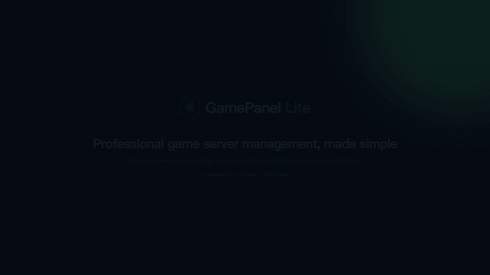

<h1 align="center">🎮 GamePanel Lite</h1>

<p align="center">
  <strong>Next-Generation, Lightweight Self-Hosted Game Server Management Platform.</strong><br>
  Deploy and manage Terraria, Don't Starve Together, Palworld, Minecraft, 7 Days to Die, and Project Zomboid servers across distributed nodes.
</p>

<p align="center">
  <a href="https://dev.gamepanel.site">🌐 Live Demo</a> ·
  <a href="#-quick-start">⚡ Quick Start</a> ·
  <a href="docs/USER_GUIDE.md">📖 User Guide</a> ·
  <a href="docs/README.zh-CN.md">🇨🇳 简体中文</a> ·
  <a href="https://github.com/smartcat999/game-panel-lite/releases">📦 Releases</a>
</p>

<p align="center">
  <a href="https://github.com/smartcat999/game-panel-lite/releases"></a>
  <a href="LICENSE"></a>
  
  
  
</p>

<p align="center">
  <a href="apps/web/public/official/gamepanel-demo-en.mp4"></a>
</p>

---

## ✨ Key Features

- **🎮 Native Multi-Game Engine**: Lifecycle and configuration management for **Terraria** (Vanilla/tModLoader), **Don't Starve Together** (forest/caves), **Palworld**, **Minecraft Java Edition**, **7 Days to Die**, and **Project Zomboid** (vanilla 42.21).
- **🌐 Distributed Multi-Node Fleet**: Seamlessly manage game servers across multiple physical machines or cloud instances from a single master dashboard with real-time network topology visualization.
- **📦 Integrated Steam Workshop & Mod Hub**: Search, install, configure dependencies, and batch-toggle mods directly through a unified modern UI.
- **⏱️ Time-Machine Snapshots & Rollback**: One-click world snapshots, backup downloads, and instant disaster recovery without touching the CLI.
- **📊 Production-Grade Observability**: Native Prometheus metrics, host & container resource tracking (CPU, RAM, Network I/O), and cluster event streaming.
- **💻 Interactive Web Console & Real-time Logs**: Low-latency SSE logs, terminal command shortcuts, and integrated player lobby management.
- **👥 Role-Aware Local Collaboration**: Administrators, operators, and read-only viewers receive distinct navigation, actions, and backend-enforced permissions inside one self-hosted panel.
- **🛡️ Container Isolation & Security**: Each game server runs in an isolated Docker container with strict CPU/memory limits and dedicated volume mounts.

---

## 🎮 Supported Games

| Game | Engine / Runtime | Mod Support | World Snapshots | Visual Configuration |
| :--- | :--- | :--- | :--- | :--- |
| **Terraria** | Vanilla / tModLoader | ✅ Steam Workshop & .tmod | ✅ Time Machine | ✅ Visual Rules Editor |
| **Don't Starve Together** | Multi-shard (Forest + Caves) | ✅ Workshop Mods & Setup | ✅ Full Cluster Backup | ✅ Shard Configs & Multipliers |
| **Palworld** | Unreal Engine 5 Dedicated | ✅ Config & Savegame | ✅ World Snapshots | ✅ World Settings & Multipliers |
| **Minecraft Java** | Paper / Fabric / Vanilla | ✅ Plugins & DataPacks | ✅ World Backup | ✅ server.properties Editor |
| **7 Days to Die** | Vanilla dedicated server | Mod server management not included | Stop-required save backup | Native server groups and sandbox rules/code |
| **Project Zomboid** | Vanilla 42.21 dedicated server | Vanilla only | Stop-required full Zomboid backup | Native server/sandbox groups and five official presets |

### New survival-game integrations

- **7 Days to Die**: Configure the world, random-map seed, server access, advanced settings and multiplayer rules. Edit sandbox options in game-style groups or use a Sandbox Code. Game-file updates are separate from runtime-image versions; check the actual server build when matching a client.
- **Project Zomboid 42.21**: Search native server and sandbox options, apply one of five verified official presets, and back up saves, configuration and account databases together. Applying a preset replaces sandbox settings while preserving server options. Existing native world identity survives configuration application and restarts. This first integration uses the vanilla map and eleven default spawn regions; Workshop/modded-server management is not included.
- **Networking and storage**: Project Zomboid publishes two UDP ports (16261/16262 inside the container). Forward both corresponding host ports for public access; FRP and cloud-firewall setup are separate. Both new providers require a stopped server for consistent backups. Game programs stay in shared image layers, with per-instance saves kept separate.

These integrations are available in `main` and candidate deployments. They do **not** announce a formal v0.2.19 release: the installer below continues to follow published release metadata. Match your Steam client to the supported server version and check free disk space before installing a large game runtime.

---

## ⚡ Quick Start

### One-line Automated Installation

Requires Linux (`amd64`), Docker Engine 24+, and Docker Compose v2+.

```bash
curl -fsSL https://raw.githubusercontent.com/smartcat999/game-panel-lite/main/scripts/install-online.sh | sh
```

Once installed, open `http://YOUR_SERVER_IP:3001` in your browser.

---

## 🏗️ Architecture

```
[ Web Dashboard (Next.js 15 + Tailwind) ] 
                 │ (REST API / SSE Streams)
[ Master Controller (Golang Chi + SQLite) ] ── [ Prometheus Observability ]
                 │ 
   ┌─────────────┴─────────────────────────────┐ (WebSocket Reverse Tunnel)
   ▼                                           ▼
[ Local Host Daemon ]                [ Worker Node Agent ]
   ├── Terraria Container (Docker)      ├── Palworld Container (Docker)
   └── DST Shard Container (Docker)     └── Minecraft Container (Docker)
```

---

## 📖 Documentation

- [User Guide (Illustrated)](docs/USER_GUIDE.md)
- [简体中文用户图文指引](docs/USER_GUIDE.zh-CN.md)
- [Architecture & Development Plan](docs/goals/V1_PLAN.md)

---

## 🤝 Feedback & Community

- [Report a Bug](https://github.com/smartcat999/game-panel-lite/issues/new?template=bug_report.yml)
- [Request a Feature](https://github.com/smartcat999/game-panel-lite/issues/new?template=feature_request.yml)
- [Join Discussions](https://github.com/smartcat999/game-panel-lite/issues)

---

## 📄 License

Licensed under the [Apache License 2.0](LICENSE).
