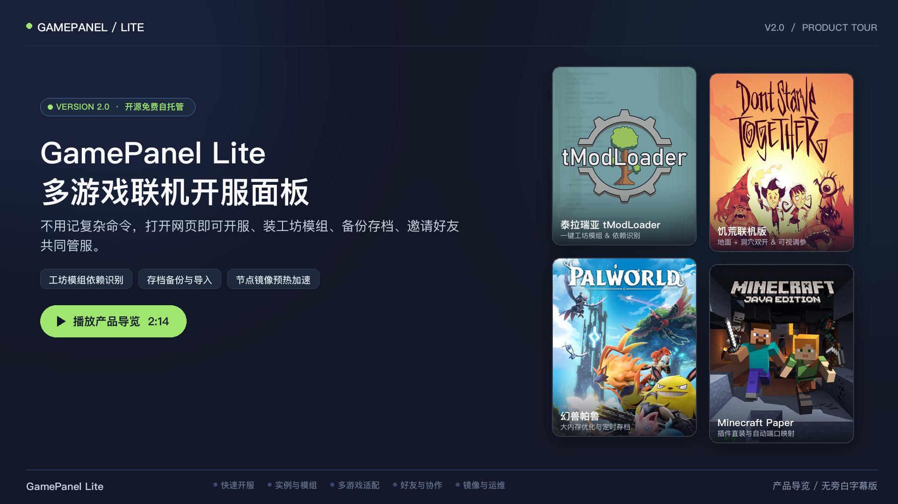

# GamePanel Lite

<p align="center">
  <strong>A Modern, Declarative, Self-Hosted Multiplayer Game Server Management Panel</strong>
</p>

<p align="center">
  <a href="https://dev.gamepanel.site">Live Demo</a> · <a href="./README.md">简体中文</a> · <a href="#quick-start">Quick Start</a> · <a href="#supported-games">Supported Games</a> · <a href="./docs/deployment-and-https.md">Deployment &amp; HTTPS</a> · <a href="./CONTRIBUTING.md">Contributing</a>
</p>

<p align="center">
  <a href="./LICENSE"></a>
  <a href="https://github.com/smartcat999/game-panel-lite/releases"></a>
  
  
  
</p>

<p align="center">
  <a href="https://cdn.jsdelivr.net/gh/smartcat999/game-panel-lite@7e3c4149f9bfbdae28b46104167644ca1a497d5b/web/public/landing/demo.mp4"></a><br />
  <strong>Silent walkthrough with Chinese captions · 2:52</strong><br />
  <a href="https://cdn.jsdelivr.net/gh/smartcat999/game-panel-lite@7e3c4149f9bfbdae28b46104167644ca1a497d5b/web/public/landing/demo.mp4#t=36">0:36 · Prewarm tasks</a> · <a href="https://cdn.jsdelivr.net/gh/smartcat999/game-panel-lite@7e3c4149f9bfbdae28b46104167644ca1a497d5b/web/public/landing/demo.mp4#t=89">1:29 · Install mods</a> · <a href="https://cdn.jsdelivr.net/gh/smartcat999/game-panel-lite@7e3c4149f9bfbdae28b46104167644ca1a497d5b/web/public/landing/demo.mp4#t=135">2:15 · Back up the world</a> · <a href="https://cdn.jsdelivr.net/gh/smartcat999/game-panel-lite@dcf4963537b5aaeace8e756a2b248a1f26748ffb/web/public/landing/demo.mp4">Browse the full feature tour</a>
</p>

> 🌐 **Live Demo**: [https://dev.gamepanel.site](https://dev.gamepanel.site) (Read-only demo account: `viewer` / password: `viewer123456`)
>
> Looking for the legacy `v0.x` codebase? See the [v1-legacy](https://github.com/smartcat999/game-panel-lite/tree/v1-legacy) branch.

---

**GamePanel Lite v2** is rebuilt from the ground up with **Go 1.26 + Next.js 15**, featuring a Kubernetes-style declarative control plane and isolated Docker runtime architecture. Designed for self-hosters and friend groups, it lets you spin up, configure, mod, back up, and monitor game servers from a clean responsive web UI without manually wrestling with SteamCMD scripts or `.ini`/`.lua` syntax.

---

## Key Features

- **Containerized One-Click Provisioning & Version Switching**
  Isolates processes, save directories, and dynamic port allocations (`20000-29999`) per server with built-in multi-version switching and custom Docker image support.
- **Visual Config Forms & Built-in Presets**
  Pre-configured gameplay presets and form schemas automatically render game config files (`server.properties`, `PalWorldSettings.ini`, `cluster.ini`, `serverconfig.xml`, etc.).
- **Steam Workshop & Modrinth Integration**
  - Install plugins and mods directly from **Steam Workshop** (browse/search with a Steam Web API Key, or paste any item/collection URL directly without an API Key) and **Modrinth / PaperMC**.
  - Deduplicated content-addressed `.blob-cache` storage with game-specific materialization modes (`flat_dir`, `tmod_latest`, `dst_local_mods`, `workshop_tree`).
- **Safe Online Backups & One-Click Restore**
  Built-in SeaweedFS S3 object storage for `tar.gz` backups and restores. For **Don't Starve Together**, backups automatically inject `c_save()` and verify both `Master` and `Caves` shards flush to disk before archiving.
- **Real-Time Web Terminal, File Manager & Cron Schedules**
  - Interactive `xterm.js` console, live log streaming, and quick action commands.
  - Web file browser with inline editing, directory creation, upload/download, and rate-limited direct streaming.
  - Cron-based scheduled restarts, backups, and server announcements.
- **Friend Invite Cards & Team Collaboration**
  Shareable join instructions tailored per game alongside RBAC-backed team collaboration (`Admin` / `Operator` / `Viewer`) and mobile-responsive UI.

---

## Supported Games

GamePanel Lite ships with **13 built-in game manifests** plus **Custom Container** support:

| Game | Category | Mods / Plugins | Recommended Minimum Spec | Manifest |
| :--- | :--- | :--- | :--- | :--- |
| **Minecraft (Java · Paper / Vanilla)** | Sandbox | Modrinth / JAR plugins (`plugins/`) | 2 vCPU / 4 GiB / 20 GiB | [01-minecraft-paper.yaml](./pkg/models/core/app/manifests/01-minecraft-paper.yaml) |
| **Palworld** | Survival | — | 4 vCPU / 8 GiB / 40 GiB | [02-palworld-dedicated.yaml](./pkg/models/core/app/manifests/02-palworld-dedicated.yaml) |
| **Terraria (Vanilla)** | Sandbox | — | 1 vCPU / 2 GiB / 10 GiB | [03-terraria-vanilla.yaml](./pkg/models/core/app/manifests/03-terraria-vanilla.yaml) |
| **Terraria (tModLoader)** | Sandbox | Steam Workshop (URL & Collection import) | 2 vCPU / 4 GiB / 20 GiB | [04-terraria-tmodloader.yaml](./pkg/models/core/app/manifests/04-terraria-tmodloader.yaml) |
| **Project Zomboid** | Survival | Steam Workshop | 4 vCPU / 8 GiB / 20 GiB | [05-project-zomboid.yaml](./pkg/models/core/app/manifests/05-project-zomboid.yaml) |
| **Don't Starve Together** | Survival | Steam Workshop + Dual-Shard Safe Backup | 2 vCPU / 4 GiB / 20 GiB | [06-dont-starve-together.yaml](./pkg/models/core/app/manifests/06-dont-starve-together.yaml) |
| **7 Days to Die** | Survival | — | 4 vCPU / 8 GiB / 40 GiB | [07-seven-days-to-die.yaml](./pkg/models/core/app/manifests/07-seven-days-to-die.yaml) |
| **Valheim** | Survival | — | 2 vCPU / 4 GiB / 20 GiB | [07b-valheim-dedicated.yaml](./pkg/models/core/app/manifests/07b-valheim-dedicated.yaml) |
| **Core Keeper** | Sandbox | — | 2 vCPU / 4 GiB / 15 GiB | [07c-core-keeper.yaml](./pkg/models/core/app/manifests/07c-core-keeper.yaml) |
| **Satisfactory** | Sandbox | — | 4 vCPU / 8 GiB / 30 GiB | [07d-satisfactory-dedicated.yaml](./pkg/models/core/app/manifests/07d-satisfactory-dedicated.yaml) |
| **Left 4 Dead 2** | Survival | Workshop / VPK addons | 2 vCPU / 2 GiB / 15 GiB | [07e-left-4-dead-2.yaml](./pkg/models/core/app/manifests/07e-left-4-dead-2.yaml) |
| **Counter-Strike 2** | FPS | — | 4 vCPU / 8 GiB / 45 GiB | [07f-counter-strike-2.yaml](./pkg/models/core/app/manifests/07f-counter-strike-2.yaml) |
| **Rust** | Survival | — | 4 vCPU / 12 GiB / 40 GiB | [07g-rust-dedicated.yaml](./pkg/models/core/app/manifests/07g-rust-dedicated.yaml) |
| **Custom Container** | Custom | — | 1 vCPU / 2 GiB / 10 GiB | [08-custom-container.yaml](./pkg/models/core/app/manifests/08-custom-container.yaml) |

---

## Quick Start

### Prerequisites

- Linux host (`x86_64`), Docker & Docker Compose v2 (`docker compose version`)
- Open firewall ports:
  - `3000/tcp` for the Web UI (or `80/443` if behind a reverse proxy)
  - `20000-29999/tcp` and `20000-29999/udp` for dynamic game server ports

### Option A: One-Line Installer (Recommended)

Downloads the compose stack, generates randomized secrets & admin password in `.env`, and starts all services:

```bash
curl -fsSL https://raw.githubusercontent.com/smartcat999/game-panel-lite/main/install.sh | bash
```

### Option B: Manual Docker Compose

```bash
git clone https://github.com/smartcat999/game-panel-lite.git
cd game-panel-lite
cp .env.example .env
# Edit .env to set strong GP_BOOTSTRAP_PASSWORD, POSTGRES_PASSWORD, GP_AUTH_JWT_SECRET, and GP_AGENT_TOKEN
docker compose up -d
```

Internal infrastructure ports (PostgreSQL, Redis, NATS, SeaweedFS, Prometheus, API Server, Node Agent) bind to `127.0.0.1` by default so only the Web UI port (`3000`) is exposed externally.

---

## Documentation

- [Deployment, HTTPS Reverse Proxy & Upgrade Guide](./docs/deployment-and-https.md)
- [Game Server Guides (DST Token, Steam API Key, Hardware Sizing)](./docs/game-guides.md)
- [Contributing & Adding New Game Manifests](./CONTRIBUTING.md)
- [Changelog](./CHANGELOG.md) · [Security Policy](./SECURITY.md)

---

## Architecture Overview

```text
├── cmd/
│   ├── apiserver/           # Declarative HTTP/WebSocket API server (OpenAPI 3.0)
│   ├── controller-manager/  # Asynchronous NATS-driven reconcilers
│   ├── node-agent/          # Host agent (Docker runtime, metrics, file/log/exec/backup proxy)
│   └── registry-worker/     # Stateless artifact syncer (Game binaries, Modrinth, Steam Workshop)
├── pkg/
│   ├── apis/                # Declarative resource specs & statuses (iam, core, registry)
│   ├── config/              # Unified configuration loader (Flags < ENV < YAML < Defaults)
│   ├── infra/               # Infrastructure drivers (db, cache, mq, s3, runtime, volume, network, addonmirror)
│   ├── repo/                # Single-domain PostgreSQL transactional stores
│   ├── models/              # Resource orchestration & built-in game manifests (pkg/models/core/app/manifests/)
│   ├── kapis/               # REST & WebSocket HTTP handlers
│   ├── apiserver/           # AuthN, additive RBAC, and NodeRestriction filter chain
│   ├── controller/          # Async controllers
│   └── agent/               # Host runtime management, .blob-cache & addon materializers
├── web/                     # Next.js 15 + React 19 + Tailwind CSS v4 console
├── docker-compose.yaml      # Single-host full-stack compose file
├── .env.example             # Environment variable template
└── install.sh               # One-click installation script
```

---

## License

Licensed under the [Apache License 2.0](./LICENSE).
